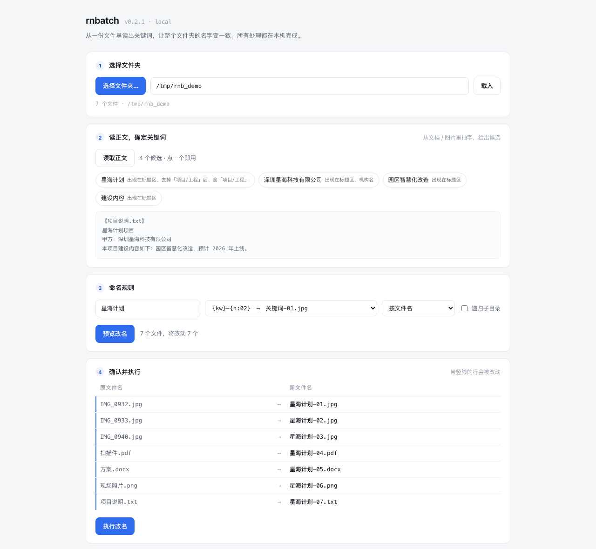

# rnbatch

**从一份文件里读出关键词，让一堆文件名字变一致。**

> 场景：一个项目文件夹里混着照片、PDF、Word、PPT、Excel，名字五花八门 ——
> `IMG_0421.JPG`、`微信图片_20261018.jpg`、`方案汇报 v3 final.pptx`。
> 而项目名「星海中心」只写在其中一份会议纪要里。
> 你要的是：所有文件都以「星海中心」为名、顺序编号、互不冲突、随时能反悔。



三种形态，同一个引擎：

| 形态 | 命令 | 适合谁 |
|---|---|---|
| **本地 Web 应用** | `rnbatch serve` | 不想碰命令行的人。浏览器里点几下就完成 |
| **命令行** | `rnbatch preview / apply` | 脚本、批处理、CI |
| **MCP server** | `rnbatch mcp` | 任何 agent（WorkBuddy / Claude Code / Cursor / Cline…）直接调用 |

```bash
$ rnbatch extract 会议纪要.docx
文件: 会议纪要.docx
会议主题：星海中心项目 一期交付启动会
甲方：恒远置业集团；乙方：筑元建筑设计有限公司

候选关键词（挑一个给 --kw 用）
  1. 星海中心                 6.2  出现在标题区、含「项目/工程」
  2. 恒远置业集团             5.5  机构名
  3. 筑元建筑设计有限公司     5.5  机构名

下一步： rnbatch preview <目录> --kw "星海中心"

$ rnbatch preview ./项目文件夹 --kw "星海中心" --template "{kw}-{n:02}-{type}"
* 会议纪要-20261020.docx     →  星海中心-01-文档.docx
* 方案汇报 v3 final.pptx     →  星海中心-02-演示.pptx
* 材料清单(1).xlsx           →  星海中心-03-表格.xlsx
* IMG_0421.JPG               →  星海中心-04-照片.JPG
* 微信图片_20261018.jpg      →  星海中心-05-照片.jpg
* 扫描件_001.pdf             →  星海中心-06-PDF.pdf

$ rnbatch apply ./项目文件夹 --kw "星海中心" --template "{kw}-{n:02}-{type}"
✅ 已改名 6 个文件
   回滚命令: rnbatch undo 20261023-210533-a1b2c3.json
```

---

## 为什么不用现成工具

改名工具和"读正文"这两件事，市面上的产品是分开的。

| 方案 | 能不能读正文取词 | 结论 |
|---|---|---|
| Finder 右键重命名 | ❌ 只能替换 / 加前缀 / 编号 | 关键词得你自己想好 |
| A Better Finder Rename 12 | ❌ 只吃 EXIF / ID3 / Spotlight **元数据** | 项目名在正文里，取不到 |
| 纳寻 namesense.app | ✅ 有 AI 按内容命名 | 要求 macOS 13+；免费版每批 3 个文件；AI 需自备 API Key |
| 通用 CLI（`f2` / `rename` / `exiftool`） | ❌ 只做字符串变换 | 关键词仍需人肉提供 |

**真正的瓶颈不是"改名"，是"哪串词才是项目名"。** 正则猜不出来，只能靠理解。
所以 rnbatch 的分工是：

- **关键词的判断交给人或 AI** —— `extract` 把正文摊开，你（或你旁边的 LLM）一眼认出关键词。
- **批量改名交给机器** —— 模板、补零、冲突消解、两阶段改名、撤销日志，机械活一件不漏。

这也是它跟 GUI 改名器最本质的区别：**它不假设你知道关键词，它帮你去文件里找。**

---

## 安装

```bash
git clone https://github.com/keyneszeng/rnbatch.git
cd rnbatch
pip install -e ".[all]"
```

最小安装（不解析文档正文，只改纯文件名）：

```bash
pip install -e .
```

依赖按需降级：缺 `python-docx` 就只读不了 docx，不影响其他格式。

| extra | 作用 |
|---|---|
| `docs` | docx / pptx / xlsx / pdf 正文抽取 |
| `ocr` | 图片 OCR（**仅 macOS**，走系统 Vision 框架，离线、不联网） |

> 图片 OCR 用的是 macOS 自带 Vision（pyobjc 桥接），支持中英混排。白板照、名片、
> 合同扫描件都能读出字。非 macOS 平台自动跳过，不影响其他功能。

---

## 用法 · 本地 Web 应用

```bash
rnbatch serve            # 默认 127.0.0.1:8765，自动开浏览器
rnbatch serve --port 9000 --no-browser
```

四步：**选文件夹 → 读正文挑关键词 → 定规则 → 预览并执行**。

- **选文件夹**用 macOS 原生选择器（服务端调 `osascript`），不用手打路径。
- **读正文**会自动优先读文档、PDF、PPT，照片放最后（OCR 慢且命中率低）。
  右侧给出候选关键词，点一下就用 —— 每个候选都标了依据（含「项目/工程」、机构名、出现 N 次）。
- **执行前必须过预览表**，带蓝色竖线的行才会被改动。
- 执行后底部弹出提示，带「撤销」按钮。

深链：`http://127.0.0.1:8765/?t=<token>&path=<urlencoded路径>&kw=星海中心`
可以直接打开某个文件夹并预填规则，适合做成书签。

> **为什么不是云端网页版**：文件是用户的核心资产，真正的痛点不是"没有界面"，
> 是"不敢把文件传上去"。所以后端跑在 `127.0.0.1`，浏览器只当画布用 ——
> 界面体验和网页版一样，但一个字节都不出机器。这一层也是将来包成桌面版的地基。

## 用法 · MCP（任何 agent 可调用）

```bash
rnbatch mcp          # stdio 传输，JSON-RPC 2.0
```

在 MCP 客户端里加一行配置即可：

```json
{
  "mcpServers": {
    "rnbatch": { "command": "rnbatch", "args": ["mcp"] }
  }
}
```

暴露 6 个工具：

| 工具 | 作用 |
|---|---|
| `list_files` | 列目录（名称/类型/大小） |
| `extract_text` | 抽正文 + 返回候选关键词 |
| `preview_rename` | 预览改名结果，**不动文件** |
| `apply_rename` | 执行改名，返回 undo 句柄 |
| `undo_rename` | 撤销 |
| `recent_renames` | 最近记录 |

server 的 `initialize` 里带了一段 `instructions`，明确告诉 agent
**「不要在用户确认前直接 apply」** —— 协议层就把安全边界写进去了。

零第三方依赖：协议本身就是换行分隔的 JSON-RPC，不需要装 MCP SDK。
细节见 [docs/AGENT.md](docs/AGENT.md)。

## 用法 · 命令行

### 1. 抽正文

```bash
rnbatch extract 会议纪要.docx              # 单个文件
rnbatch extract ./文件夹 --max-files 4     # 一次看几个候选
rnbatch extract 白板照片.png --limit 800   # 图片走 OCR
```

### 2. 预览（必做）

```bash
rnbatch preview ./文件夹 --kw "星海中心" --template "{kw}-{n:02}"
```

### 3. 执行

```bash
rnbatch apply ./文件夹 --kw "星海中心" --template "{kw}-{n:02}"
```

### 4. 后悔

```bash
rnbatch undo              # 撤销最近一次
rnbatch undo 20261023-….json   # 撤销指定批次
rnbatch logs              # 看看历史记录
```

---

## 模板

| 占位符 | 含义 | 例 |
|---|---|---|
| `{kw}` | 关键词 | 星海中心 |
| `{n}` | 序号，宽度自动 | 01 |
| `{n:03}` | 强制补零 3 位 | 001 |
| `{orig}` | 原文件名（不含扩展名） | 方案汇报 v3 final |
| `{date}` | 文件修改日期 | 20261018 |
| `{type}` | 中文类型标签 | 照片 / PDF / 文档 / 表格 / 演示 |
| `{ext}` | 扩展名（不写也会自动保留） | jpg |

```bash
--template "{kw}-{n:02}"          # 星海中心-01.jpg
--template "{kw}-{n:02}-{type}"   # 星海中心-01-照片.jpg   ← 混合格式最好用
--template "{kw}-{orig}"          # 星海中心-方案汇报 v3 final.pptx
--template "{kw}-{date}-{n:02}"   # 星海中心-20261018-01.jpg
```

其他参数：

| 参数 | 说明 |
|---|---|
| `--sort name\|date\|mtime_desc\|size` | 序号排序依据，默认 `name`；照片按时间排用 `date` |
| `--start 5` | 序号从 5 起（分批接续） |
| `--pad 3` | 固定补零位数 |
| `--recursive` | 递归子目录 |
| `--only pdf,jpg` | 只处理指定扩展名 |

---

## 三条设计原则

**1. 永不静默改名。** `preview` 和 `apply` 是两个命令，中间隔着人的一次确认。

**2. 永不不可逆。** 每次 `apply` 都往 `~/.rnbatch/undo/` 写一份 JSON 日志，
`undo` 一条命令全还原。日志是可读的，出问题能手改。

**3. 永不互相覆盖。** 改名走两阶段（原名 → 临时名 → 终名），
`A→B, B→A` 这种互换不会丢文件；目标名已被占用时**直接报错并回滚**，不猜你的意图。

---

## 边界情况怎么处理

这些行为都是拿真实目录反复试出来的，不是拍脑袋定的。改动前先看
[CHANGELOG.md](CHANGELOG.md) 里对应那条踩坑记录。

| 情况 | 行为 | 为什么 |
|---|---|---|
| 目标名已被占用 | 预览标红 `⚠ 已被占用`，`apply` 拒绝执行，**一个文件都不碰** | 让用户在动手前就知道，而不是点完才炸 |
| 名字超过 200 字节 | 按 UTF-8 字节截断，预览里提示「哪几个被截断了」 | APFS 理论 255，但备份/同步工具会拼后缀，实测 240 就开始 `ENAMETOOLONG` |
| 符号链接 | 跳过，并在预览里报出跳过了几个 | 改链接名会让它指向的原文件也跟着改，链接当场断 |
| 隐藏文件（`.DS_Store` 等） | 跳过 | 几乎不会是用户想改的 |
| `A→B, B→A` 互换 | 正常完成 | 两阶段改名先全挪到临时名，再落到终名 |
| 上次改名中途被杀 | 下次 `apply` 提示残留的 `.rnbatch.tmp.*` 并跳过 | 别让临时文件混进新批次 |
| 撤销日志损坏 | 跳过损坏的，用最近一份能用的；全坏了才报错 | 不能因为一份坏文件就永远撤销不了 |
| 扫描版 PDF（无文字层） | 明确提示「需要 OCR」，并自动顺延到下一个文件 | 不能让它白占抽取名额 |
| 同名不同扩展名（`a.jpg` / `a.png`） | 各自保留扩展名，序号递增 | 不会互相覆盖 |
| 参数写错（`--start abc`、`only` 传数字） | 用默认值兜住，不整次失败 | agent 调用时传参不规范是常态 |

---

## 架构

```
src/rnbatch/
├── engine.py      模板渲染 · 冲突消解 · 两阶段改名 · 撤销   ← 核心，零依赖
├── extract.py     正文抽取（docx/pptx/xlsx/pdf/纯文本/图片OCR）
├── keywords.py    候选关键词启发式打分
├── cli.py         命令行
├── server.py      本地 Web 应用（HTTP + 原生文件夹选择器）
├── mcp_server.py  MCP server（stdio JSON-RPC，零依赖）
└── web/index.html 单页界面
```

分层原则：**引擎不知道界面的存在**。CLI、Web、MCP 三个入口都只是
`plan()` / `apply_plan()` / `undo()` 的薄包装，所以三者行为永远一致，
新增入口的成本接近于零。

引擎还是纯函数式的：`plan()` 只算不碰文件，`apply_plan()` 才落盘。
所以测试可以在临时目录里跑完整流程，不需要 mock 文件系统。

```bash
python -m unittest discover -s tests     # 95 个测试
```

---

## 集成

- `integrations/workbuddy/SKILL.md` —— 给 [WorkBuddy](https://www.workbuddy.cn) 用的技能定义。
- `integrations/macos/` —— 拖放式 App 的 AppleScript 源码（不想开终端时用）。
- MCP 配置见 [docs/AGENT.md](docs/AGENT.md)，覆盖 Claude Code / Cursor / Cline 等客户端。

---

## 状态

`v0.2.1` —— 三种形态都能跑，在真实项目文件夹上验证过（改名 + 回滚 + 95 个测试）。
这一版专门做了一轮压测：拿边界样本（超长名、非法字符、同名不同扩展名、符号链接、
NFD 编码、加密 PDF、畸形 JSON-RPC 请求）逐个试，挖出并修掉 20 多个问题，
明细见 [CHANGELOG.md](CHANGELOG.md)。

**接近可用，还不是产品。**

已知限制：

- 扫描版 PDF（无文字层）读不出正文 —— 目前只对图片做 OCR，PDF 还没接。
- 关键词候选是启发式打分，不是模型判断。够用，但不如 LLM 准；
  真正的判断仍建议交给 agent 或人。
- 只支持本地文件系统，不做跨卷 / 网络盘的原子改名。
- Web 应用的文件夹选择器依赖 macOS `osascript`；其他平台要手输路径。
- 没有打包成独立 .app，启动要一条命令。

后续方向见 [docs/ROADMAP.md](docs/ROADMAP.md)，商业化思考见 [docs/COMPETITIVE.md](docs/COMPETITIVE.md)。

---

## License

MIT —— 见 [LICENSE](LICENSE)。
如需改为 AGPL / 双许可 / 专有，是 LICENSE 一行的事，先谈。
